# Patron Radar

GTM agent that turns your past clients into live personas, finds lookalike sponsors, and helps you outreach — with a knowledge graph the agent actually understands.

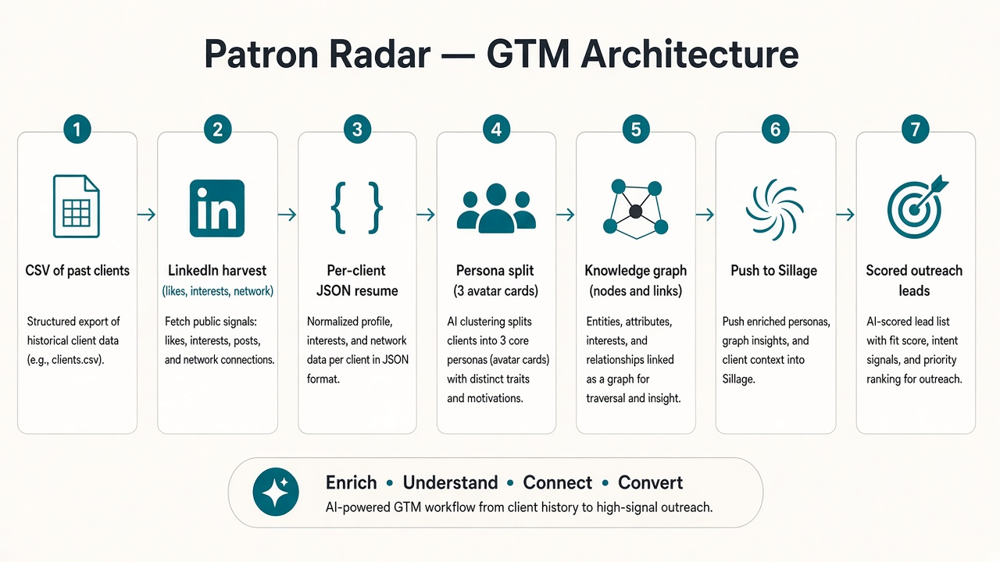

---

## How it works

1. **Upload a CSV** of previous clients (or describe them in chat).
2. **Harvest LinkedIn** — likes, interests, who they engage with.
3. **Resume layer** — AI builds a JSON summary per client.
4. **Analyze layer** — summaries are clustered into **personas**.
5. **Knowledge graph** — patron graph so the agent sees roles, industries, and triggers.
6. **Push to Sillage** — go live; agents hunt matching potential clients.
7. **Score & outreach** — match score + enrich confidence; draft and send emails.
8. **Owner confirmation** — you review; saved runs feed the next persona loop.

---

## AI layers

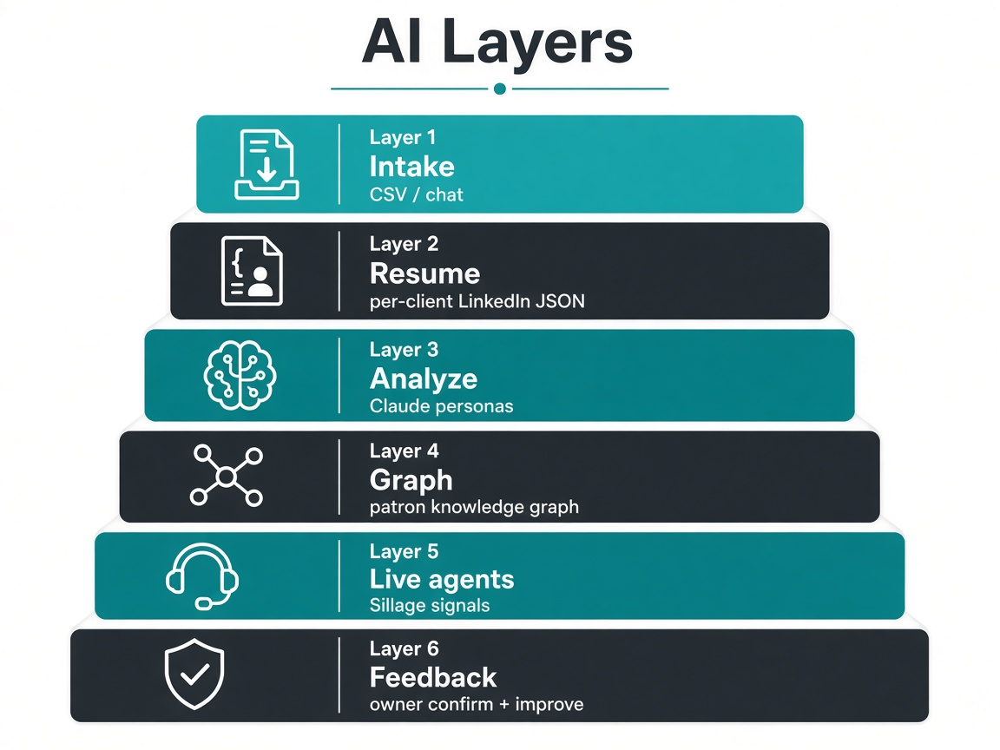

| Layer | Job |
|---|---|
| Intake | CSV / chat → donor rows |
| Resume | Per-client LinkedIn activity → JSON |
| Analyze | Claude → refined personas |
| Graph | Patron knowledge graph (D3) |
| Live agents | Sillage persona + signal runs |
| Feedback | Owner review → push / save → improve |

---

## Product UI

### 1. Intake

Drop a CSV of past clients or describe your donors.

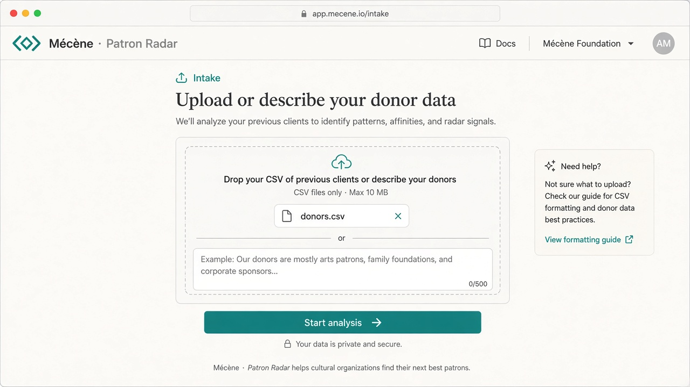

### 2. Processing

The pipeline seeds accounts, harvests activity, and profiles archetypes.

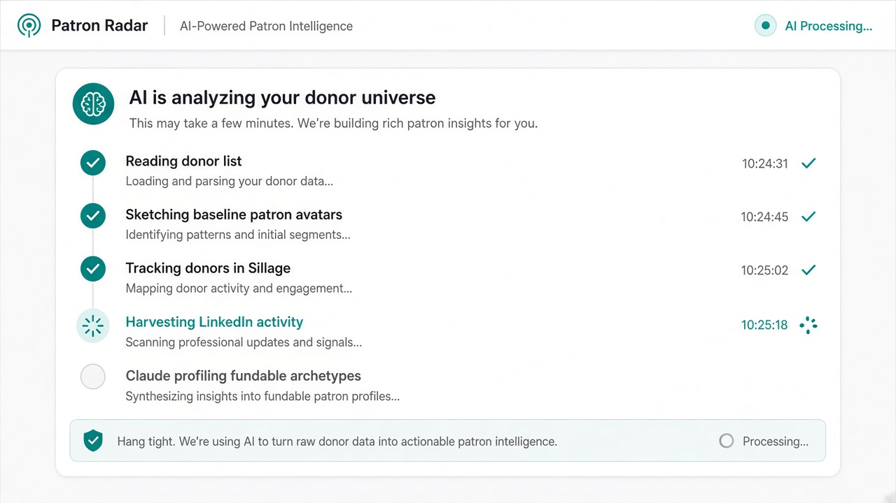

### 3. Patron graph + personas

Review the knowledge graph and persona cards, then push when you’re ready.

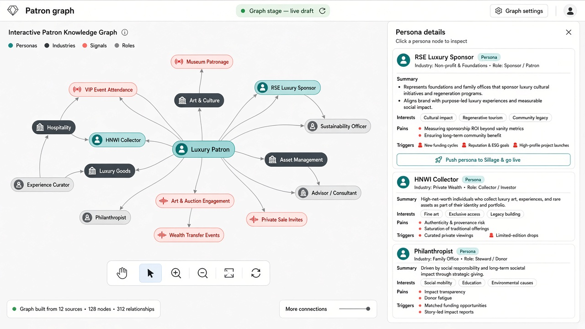

### 4. CRM & outreach

Incoming signals, match scores, enrich, and AI-written outreach.

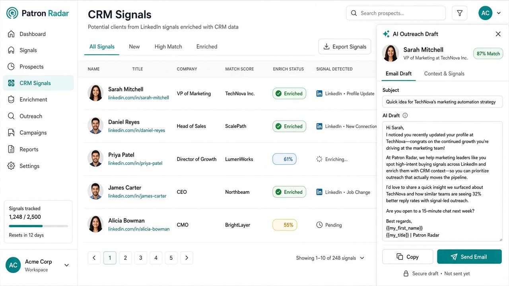

---

## Stack

- **Claude** — resume / persona analysis  
- **Sillage** — LinkedIn harvest, persona, live agents  
- **FullEnrich** — email enrichment + confidence  
- **Resend** — send outreach  
- **Next.js** — GTM UI in `hakathongtm/` (`:3001`)  
- **fr1** (optional) — sponsor video + landing pack (`:3000`)
  - **Gamma** — presentation + public landing page  
  - **Gradium** — TTS voiceover  
  - **FFmpeg** — slide clips + final MP4 concat  
///
---

## Run it

```bash
# GTM app
cd hakathongtm
npm install
cp ../.env.example .env.local   # fill Sillage, Anthropic, etc.
npm run dev                     # http://localhost:3001
```

Optional sponsor packs (video + landing page):

```bash
# from repo root — needs ffmpeg/ffprobe on PATH
npm install
cp .env.example .env.local      # Gamma, Gradium, Anthropic
npm run dev                     # http://localhost:3000
```

Set `SPONSOR_PACK_API_URL=http://localhost:3000` in the GTM env if you use packs.

More integration detail: [`INTEGRATION_PLAN.md`](INTEGRATION_PLAN.md).

---

## Optional: Sponsor packs

After personas are ready, **fr1** turns each avatar into a full pack:

1. AI-written slide scripts (Claude)  
2. Editable **Gamma** presentation  
3. Public **Gamma** landing page  
4. Natural **Gradium** voiceover  
5. Polished narrated **MP4** (FFmpeg)

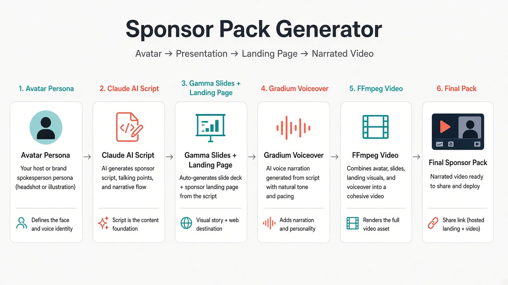

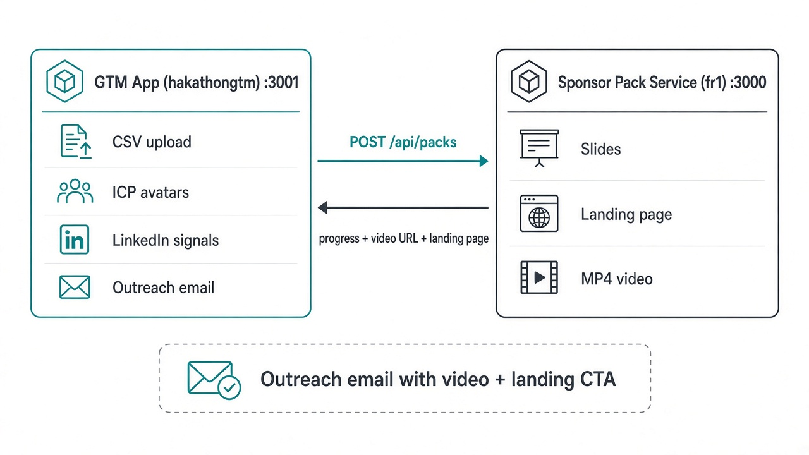

### Pack pipeline

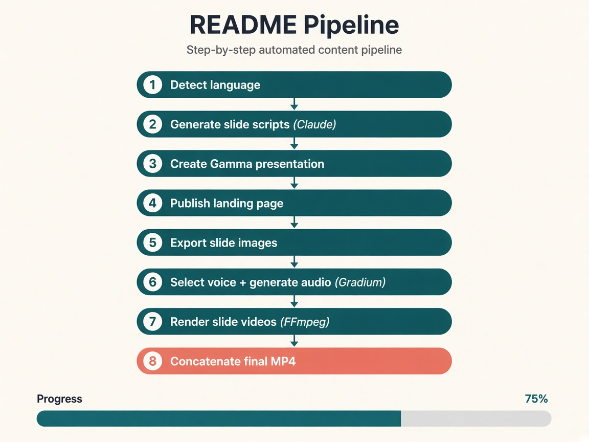

| Step | What happens |
|---|---|
| 1. Language | Detect from avatar text (or override) |
| 2. Script | Claude writes slides + conversational voiceover |
| 3. Presentation | Gamma creates an editable deck |
| 4. Landing page | Gamma publishes a public site |
| 5. Export | Slide images from Gamma |
| 6. Voice | Gradium selects/pins a voice and generates audio |
| 7. Render | FFmpeg builds one clip per slide |
| 8. Concat | Final MP4 with transitions |

Progress streams over **SSE**, or use async mode and poll.

### Pack UI

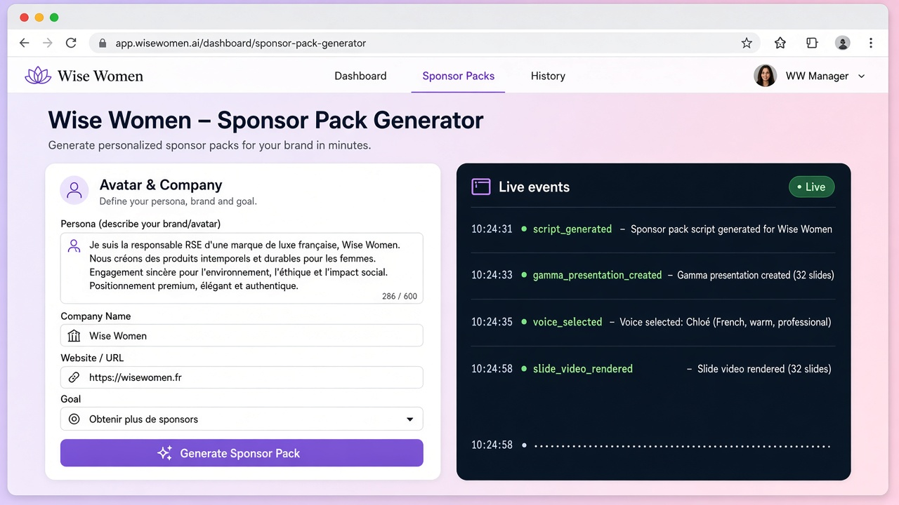

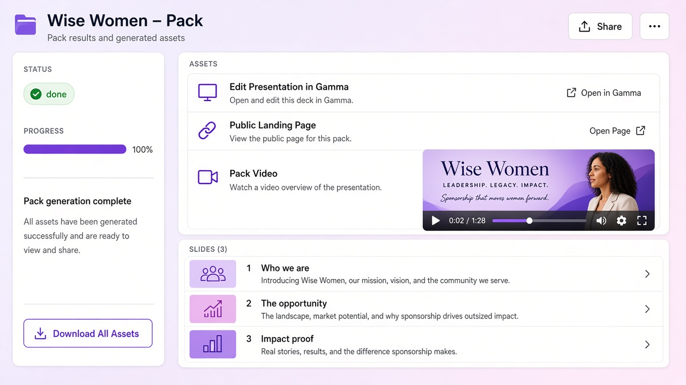

### Environment (fr1)

Copy [`.env.example`](.env.example) → `.env.local`:

```bash
ANTHROPIC_API_KEY=...
GAMMA_API_KEY=...
GRADIUM_API_KEY=...
NEXT_PUBLIC_APP_URL=http://localhost:3000
MOCK_LANDING_PAGE=false   # true skips Gamma landing gen in demos
```

Prerequisite: **ffmpeg** + **ffprobe** (`brew install ffmpeg` on macOS).

### API (compact)

Base: `http://localhost:3000`

| Endpoint | Role |
|---|---|
| `POST /api/packs` | Create pack; SSE progress; header `X-Pack-Id` |
| `POST /api/packs?async=1` | `202` + `{ packId, progressUrl }` — poll instead |
| `GET /api/packs` | List packs (`?avatarId=` filter) |
| `GET /api/packs/:id` | Full pack (slides, events, URLs) |
| `GET /api/packs/:id/progress` | Status %, readiness, edit/landing/video URLs |
| `GET /api/packs/:id/stream` | SSE for an existing pack |

Example payload: [`examples/wise-women-avatar.json`](examples/wise-women-avatar.json).

Async example:

```bash
curl -X POST 'http://localhost:3000/api/packs?async=1' \
  -H 'Content-Type: application/json' \
  -d @examples/wise-women-avatar.json
```

### Tips

- Write avatars in the language you want on slides and voiceover.  
- Set `speaker.voiceId` to pin a Gradium voice.  
- Add `logoUrl` / `referenceImageUrls` so Gamma stays on-brand.  
- Set `NEXT_PUBLIC_APP_URL` so other apps get an absolute `videoAbsoluteUrl`.

### Troubleshooting

| Issue | Fix |
|---|---|
| Video step fails | Install ffmpeg/ffprobe and restart |
| Gamma / Gradium errors | Check API keys and quotas in `.env.local` |
| Empty landing URL | Check `MOCK_LANDING_PAGE` |
| Other app can’t load video | Set reachable `NEXT_PUBLIC_APP_URL` |
| Pack lost after restart | Packs are in-memory; generate again |
